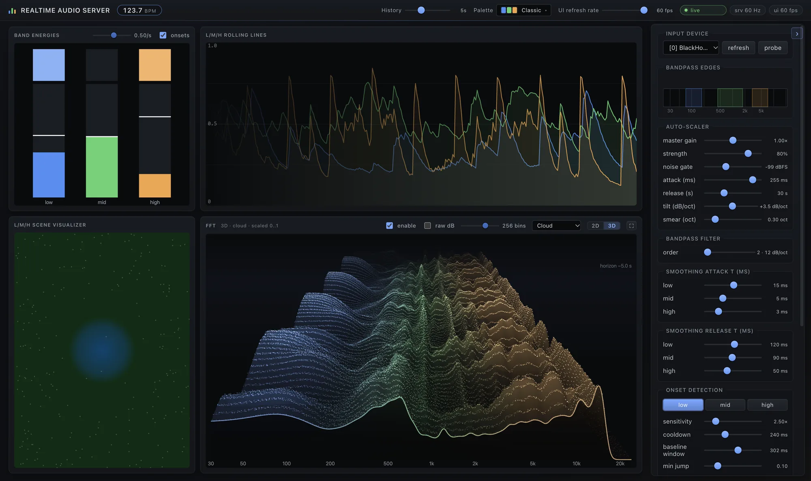
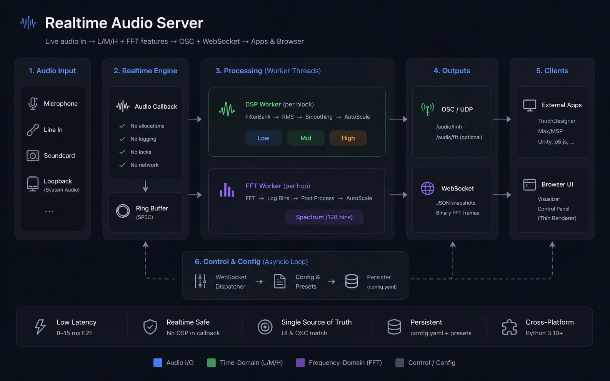

<h1 align="center">BUTCHER 3.0</h1>

<p align="center">
  <b>Live audio in → clean, auto-scaled features out over OSC + WebSocket.</b><br>
  A realtime audio feature server written in Rust, with a browser UI for live tuning.
</p>

## Features

| | |
|---|---|
| **Band energies** | Three independent bandpasses (low / mid / high), each smoothed, noise-gated and auto-scaled to a stable `[0, 1]` signal. |
| **FFT spectrum** | 16–1024 log-spaced bins, auto-scaled through the same pipeline or sent as raw dB. |
| **Onsets and tempo** | Per-band onset triggers for kick, snare and hi-hat style transients, plus a BPM estimate from the low band. |
| **OSC output** | UDP at audio-block rate (~187 Hz) to any number of destinations, including a subnet broadcast address. |
| **Browser UI** | Tune every parameter live and pick the input device. The UI does no signal processing: the 2D FFT graph renders the exact bytes sent on `/audio/fft`. |
| **Realtime-safe** | The audio callback never allocates, locks or logs. All DSP runs in real-time-scheduled worker threads. |
| **Persistence** | Every setting is saved to `configs/main.yaml`. Named presets can be saved and loaded. |

<p align="center">
  
</p>

## Quick start

You need the Rust toolchain via [rustup](https://rustup.rs). The exact Rust version is pinned in `engine/rust-toolchain.toml` and installed automatically on the first build.

```bash
curl --proto '=https' --tlsv1.2 -sSf https://sh.rustup.rs | sh   # once
sudo apt install libasound2-dev pkg-config                         # Linux only (ALSA headers)

git clone https://github.com/M-E-A-T/BUTCHER-3.0.git
cd BUTCHER-3.0
make start            # release build + server + UI in your browser
```

The UI lives at **http://127.0.0.1:8766** (WebSocket on 8765). Pick the audio input from **Input device** in the side panel.

To run the binary directly after `make build`:

```bash
engine/target/release/audio-server [flags]
```

| Flag | What it does |
|---|---|
| `--open` | Open the UI in your default browser |
| `--device N` | Use input device `N` (pick it in the UI otherwise) |
| `--no-ws` | Headless: OSC only, no UI or WebSocket |
| `--config PATH` | Use another config file instead of `configs/main.yaml` |
| `--log-level DEBUG` | More logging |

> [!TIP]
> To react to what your computer is *playing* rather than a mic, route system audio into a loopback device ([BlackHole](https://github.com/ExistentialAudio/BlackHole) on macOS, a loopback / monitor device on Linux or Windows) and select it as the input.

## Receiving features over OSC

| Address | Args | When |
|---|---|---|
| `/audio/lmh` | `low mid high` (floats, `~[0, 1]`) | Every audio block (~187 Hz) |
| `/audio/onset/low` · `/mid` · `/high` | `1` | Once per detected onset on that band (no `0`s are sent) |
| `/audio/bpm` | `bpm` | Every block. Octave-folded into 60–180, `0` until locked or after 5 s of silence |
| `/audio/fft` | `n_bins` floats | Every FFT hop (~94 Hz), only when `osc.send_fft: true` |
| `/audio/meta` | `sr blocksize n_fft_bins low_lo low_hi mid_lo mid_hi high_lo high_hi` | On start, on changes, and once a second |

FFT bins are auto-scaled `[0, 1]` by default. Tick **raw dB** in the UI (or set `fft.send_raw_db: true`) to get the raw log spectrum instead.

Destinations live in `configs/main.yaml`. Stop the server before editing it: the server rewrites the file whenever a setting changes in the UI.

```yaml
osc:
  destinations:
    - { host: 127.0.0.1, port: 9000 }      # this machine
    - { host: 10.10.10.255, port: 9000 }   # every machine on the 10.10.10.x network (broadcast)
  send_fft: true
```

Broadcast goes out on whichever network interface matches the address (here the one on `10.10.10.x`). Receivers just listen on the UDP port.

**TouchDesigner / Max:** point an OSC In CHOP / `udpreceive` at the port; `/audio/lmh` arrives as three channels.

## Controlling the server over WebSocket

Connect to `ws://127.0.0.1:8765`. The server sends JSON text frames (`meta`, `snapshot`, `devices`, `presets`, `server_status`, `error`) plus binary FFT frames, and accepts JSON commands such as:

```js
ws.send(JSON.stringify({ type: "set_band", band: "low", lo_hz: 40, hi_hz: 160 }));
ws.send(JSON.stringify({ type: "set_device", index: 2 }));
```

Binary FFT frame: `[type=1:u8][reserved:u8][n_bins:u16 LE][float32 × n_bins LE]`, the same values as `/audio/fft`.

## How it works

<p align="center">
  
</p>

- **The audio callback does almost nothing.** It mixes to mono, copies the block into a lock-free ring buffer and wakes two workers.
- **DSP worker** (once per 256-sample block): bandpass filter bank → RMS → smoothing → auto-scaler (peak follower + noise gate + tanh) → onset detection → OSC.
- **FFT worker** (once per hop): windowed FFT → log-spaced bins → the same per-bin auto-scaler → OSC + WebSocket.
- **The control loop** runs the WebSocket server, the UI's static HTTP server, the command handler and the debounced config writer.
- **The audio watchdog** sends silence to OSC and keeps trying to reopen the device when the input dies (e.g. an unplugged USB interface).

## Layout

```
engine/   Rust workspace: dsp (signal-processing library) + server (the audio-server binary)
ui/       Browser UI: plain ES modules, no build step
configs/  main.example.yaml (defaults); main.yaml + presets are created at runtime
testdata/ Wire-format captures used by the Rust tests
```

Run the tests with `make test`.

## License

[MIT](LICENSE). Based on [Realtime_PyAudio_FFT](https://github.com/aiXander/Realtime_PyAudio_FFT) by Xander Steenbrugge.
